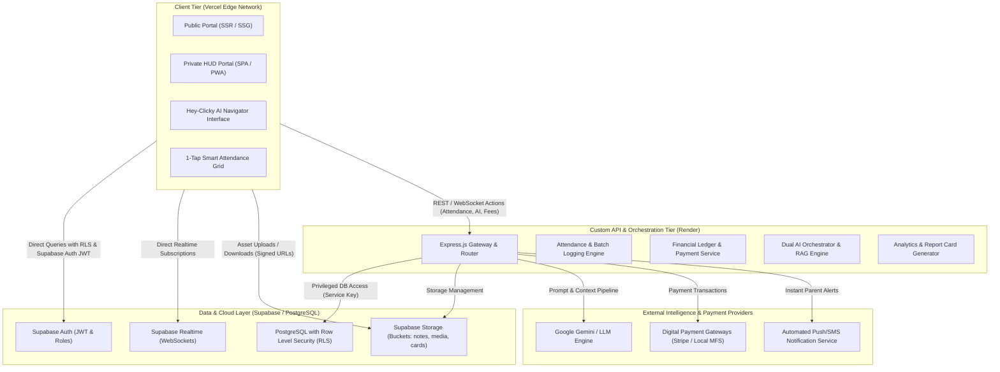
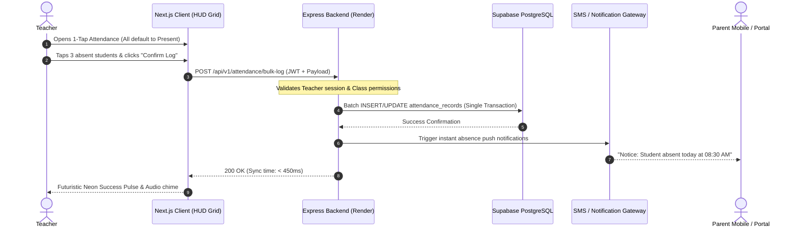
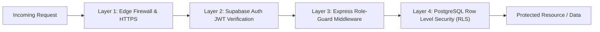
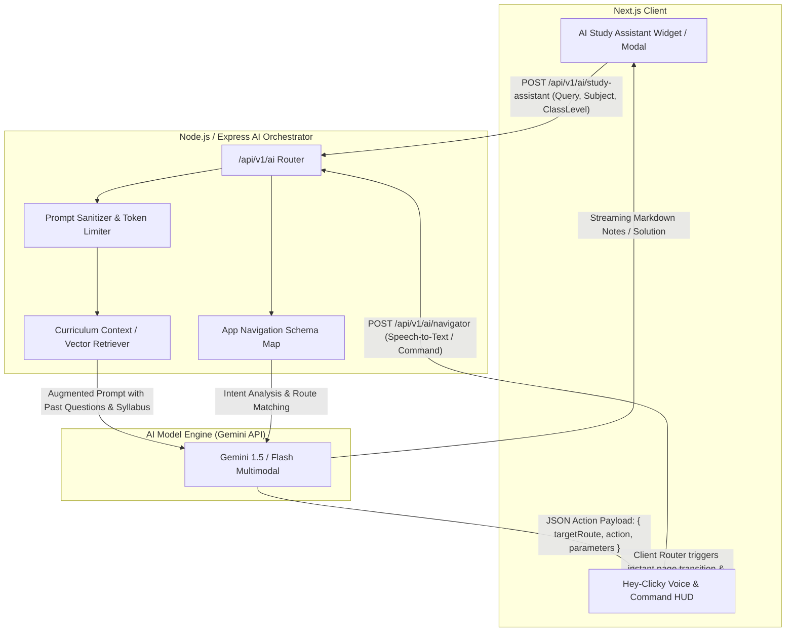

# Technical Architecture Document (TAD) - CampusHub
## The Next-Gen Futuristic Smart School Ecosystem

---

## 1. High-Level Architecture Overview

CampusHub adopts a modern decoupled hybrid-cloud architecture engineered for high speed, low latency, and infinite scalability. It bridges a high-performance Next.js client tier, a custom Node.js/Express orchestration backend, and a cloud-native Supabase infrastructure (PostgreSQL, Auth, Storage, and Realtime Engine).

### Core Architecture Components
1. **Frontend Client (Next.js & Framer Motion on Vercel):**
   - Serves the cyber-school glassmorphic UI (`backdrop-blur-md`, glowing HUD counters, neon accents).
   - Direct read capabilities from Supabase using Row-Level Security (RLS) for ultra-fast, cached responses.
   - Reactive global state for notifications, user sessions, and "Hey-Clicky" voice/text overlay.

2. **Backend API Service (Node.js & Express on Render):**
   - Handles multi-record transactions (e.g., 1-minute attendance bulk submission, financial audit logs).
   - Manages secret API keys, prompt construction, and context injection for the Dual AI System.
   - Calculates dynamic GPA sheets, generates automated certificates, and handles payment webhooks.

3. **Database & Storage Core (Supabase / PostgreSQL):**
   - Fully relational schema with foreign key constraints, indexes, and automated audit triggers.
   - Integrated Row-Level Security ensuring strict multi-tenant and role-level isolation.
   - Scalable bucket storage for student documents, assignments, club projects, and school galleries.

---

## 2. Communication Flow Between Subsystems

CampusHub employs a **Dual-Path Communication Model** to maximize performance while securing business logic:

1. **Path A (Direct Edge Data Path):** For high-frequency, read-heavy operations (e.g., loading notice boards, browsing student profiles, fetching personal grades), the Next.js client connects directly to Supabase via `@supabase/supabase-js` leveraging RLS.
2. **Path B (Orchestrated Backend Path):** For high-integrity workflows, bulk actions, and external integrations (e.g., AI inference, fee collection, bulk attendance verification), the client routes requests through the Express API.

### Typical Sequence: 1-Minute Bulk Attendance Logging

---

## 3. Security Layers & Role-Based Access Control (RBAC)

Security is implemented using defense-in-depth across the client, API gateway, and database layers.

### Role Matrix

| Role | Access Scope | Accessible Areas | Key Permissions |
| :--- | :--- | :--- | :--- |
| **Admin** | Full Campus Ecosystem | All Modules & System Settings | Full CRUD on users, fee ledger, curriculum, logs, and global notices. |
| **Teacher** | Assigned Classes & Clubs | 1-Tap Attendance, Gradebook, Club Management, AI Study Hub | Log attendance, issue grades, create study material, broadcast announcements. |
| **Student** | Personal Data & Learning Hubs | Virtual Labs, Dual AI Assistant, Gradebook, Club Hubs | Access notes, ask AI doubts, view personal progress, submit club projects. |
| **Parent** | Linked Student Data | Child's Attendance, Report Cards, Fee Payment, School Notices | View child's stats, pay tuition digitally, view attendance trends. |
| **Public** | Unauthenticated Public Scope | School Showcase, Public Notice Board, Admission Hub | View galleries, read public news, submit student admission applications. |

### PostgreSQL Row-Level Security (RLS) Rules Strategy
- `attendance_records`: Students and parents can only `SELECT` records where `student_id = auth.uid()` or linked parent relationship. Teachers can `INSERT/UPDATE` only for their allocated `class_section_id`.
- `financial_ledger`: Strictly accessible to users with `role = 'admin'` via service keys.
- `clubs`: Public view for registered students, write permissions restricted to assigned club moderators/teachers.

---

## 4. Dual AI System Integration Architecture

CampusHub embeds two specialized AI engines designed for distinct cognitive roles:

### 1. AI Study Assistant (For Students & Teachers)
- **Functions:**
  1. Generates concise summary revision sheets for complex curriculum concepts.
  2. Analyzes past board questions and textbook sections to generate high-yield mock tests.
  3. Context-aware doubt clearing chatbot tuned specifically to national and school-specific curricula.
- **Protocol:** Server-Sent Events (SSE) for real-time word-by-word streaming to the glassmorphic terminal interface.

### 2. AI Navigator / "Hey-Clicky" (For Whole-App Voice & Text Navigation)
- **Functions:**
  1. Voice and text-commanded omni-search (e.g., *"Take me to Class 10 Physics attendance"*, *"Pay pending tuition fees"*).
  2. Converts natural language inputs into precise application actions using structured JSON output.
  3. Interacts with Next.js router and deep-links directly into target records, tables, or modals with subtle glowing highlights.

---

## 5. Deployment Topology & Environments

- **Frontend Platform:** Hosted on **Vercel** with automatic global CDN edge caching, optimized for Next.js Server Components and dynamic Framer Motion bundles.
- **Backend Platform:** Deployed on **Render** (Node.js runtime environment) with environment-variable-backed secret isolation, automated health checks, and autoscaling.
- **Database & Storage:** Managed **Supabase** instance (PostgreSQL 15+) hosted with automatic daily backups, connection pooling (PgBouncer), and geo-distributed S3-compatible asset storage.

