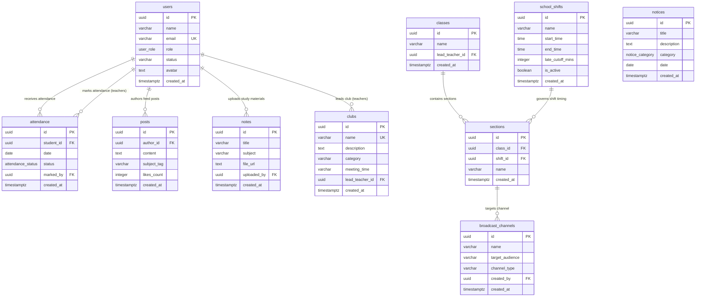

# PostgreSQL Database Schema Specification - CampusHub
## The Next-Gen Futuristic Smart School Ecosystem (Supabase / PostgreSQL)

---

## 1. Entity-Relationship (ER) Diagram



---

## 2. PostgreSQL Enumerated Types (ENUMs)

```sql
-- Role-based access control enum
CREATE TYPE user_role AS ENUM (
    'admin',
    'teacher',
    'student',
    'parent'
);

-- Attendance status enum for instant 1-tap logging
CREATE TYPE attendance_status AS ENUM (
    'present',
    'absent',
    'late'
);

-- Notice priority & classification enum
CREATE TYPE notice_category AS ENUM (
    'urgent',
    'general',
    'exam'
);
```

---

## 3. Database Table Definitions & DDL Scripts

### 3.1. `users` Table
Stores authentication metadata and user profiles across all school roles. Synchronized with Supabase `auth.users`.

```sql
CREATE TABLE users (
    id UUID PRIMARY KEY REFERENCES auth.users(id) ON DELETE CASCADE,
    name VARCHAR(255) NOT NULL,
    email VARCHAR(255) UNIQUE NOT NULL,
    role user_role NOT NULL DEFAULT 'student',
    status VARCHAR(50) NOT NULL DEFAULT 'active', -- 'active', 'deactivated', 'suspended'
    avatar TEXT DEFAULT 'https://images.unsplash.com/photo-1534528741775-53994a69daeb?auto=format&fit=crop&w=256&q=80',
    created_at TIMESTAMPTZ DEFAULT TIMEZONE('utc', NOW()) NOT NULL
);

-- Indexes
CREATE INDEX idx_users_role ON users(role);
CREATE INDEX idx_users_email ON users(email);
CREATE INDEX idx_users_status ON users(status);

--------------------------------------------------------------------------------
-- 3.1.1. School Shifts & Timetable Policy
--------------------------------------------------------------------------------
CREATE TABLE school_shifts (
    id UUID PRIMARY KEY DEFAULT gen_random_uuid(),
    name VARCHAR(100) NOT NULL, -- e.g. 'Morning Shift', 'Day Shift'
    start_time TIME NOT NULL DEFAULT '08:00:00',
    end_time TIME NOT NULL DEFAULT '13:30:00',
    late_cutoff_mins INTEGER NOT NULL DEFAULT 15,
    is_active BOOLEAN NOT NULL DEFAULT true,
    created_at TIMESTAMPTZ DEFAULT TIMEZONE('utc', NOW()) NOT NULL
);

--------------------------------------------------------------------------------
-- 3.1.2. Dynamic Classes & Sections
--------------------------------------------------------------------------------
CREATE TABLE classes (
    id UUID PRIMARY KEY DEFAULT gen_random_uuid(),
    name VARCHAR(100) NOT NULL, -- e.g. 'Class 10'
    lead_teacher_id UUID REFERENCES users(id) ON DELETE SET NULL,
    created_at TIMESTAMPTZ DEFAULT TIMEZONE('utc', NOW()) NOT NULL
);

CREATE TABLE sections (
    id UUID PRIMARY KEY DEFAULT gen_random_uuid(),
    class_id UUID NOT NULL REFERENCES classes(id) ON DELETE CASCADE,
    shift_id UUID REFERENCES school_shifts(id) ON DELETE SET NULL,
    name VARCHAR(100) NOT NULL, -- e.g. 'Science Section Alpha'
    created_at TIMESTAMPTZ DEFAULT TIMEZONE('utc', NOW()) NOT NULL
);

--------------------------------------------------------------------------------
-- 3.1.3. Targeted Broadcast & Group Chat Channels
--------------------------------------------------------------------------------
CREATE TABLE broadcast_channels (
    id UUID PRIMARY KEY DEFAULT gen_random_uuid(),
    name VARCHAR(150) NOT NULL,
    target_audience VARCHAR(100) NOT NULL, -- e.g. 'Class 10 - Alpha', 'All Teachers'
    channel_type VARCHAR(50) NOT NULL DEFAULT 'broadcast', -- 'broadcast', 'discussion'
    created_by UUID NOT NULL REFERENCES users(id) ON DELETE CASCADE,
    created_at TIMESTAMPTZ DEFAULT TIMEZONE('utc', NOW()) NOT NULL
);
```

### 3.2. `attendance` Table
High-speed attendance logging table supporting the 1-Minute Attendance Grid and RFID/QR tap simulations.

```sql
CREATE TABLE attendance (
    id UUID PRIMARY KEY DEFAULT gen_random_uuid(),
    student_id UUID NOT NULL REFERENCES users(id) ON DELETE CASCADE,
    date DATE NOT NULL DEFAULT CURRENT_DATE,
    status attendance_status NOT NULL DEFAULT 'present',
    marked_by UUID NOT NULL REFERENCES users(id) ON DELETE RESTRICT,
    created_at TIMESTAMPTZ DEFAULT TIMEZONE('utc', NOW()) NOT NULL,
    
    -- Constraint: A student can only have one attendance status per day
    CONSTRAINT unique_student_daily_attendance UNIQUE (student_id, date)
);

-- Indexes for lightning fast daily reports and student profile queries
CREATE INDEX idx_attendance_student_id ON attendance(student_id);
CREATE INDEX idx_attendance_date ON attendance(date);
CREATE INDEX idx_attendance_status ON attendance(status);
```

### 3.3. `posts` Table (Social Feed / Community Hub)
Powers the futuristic school social feed, student project showcases, and teacher subject discussions.

```sql
CREATE TABLE posts (
    id UUID PRIMARY KEY DEFAULT gen_random_uuid(),
    author_id UUID NOT NULL REFERENCES users(id) ON DELETE CASCADE,
    content TEXT NOT NULL,
    subject_tag VARCHAR(100),
    likes_count INTEGER DEFAULT 0 CHECK (likes_count >= 0),
    created_at TIMESTAMPTZ DEFAULT TIMEZONE('utc', NOW()) NOT NULL
);

-- Indexes for timeline feeds and subject filtering
CREATE INDEX idx_posts_author_id ON posts(author_id);
CREATE INDEX idx_posts_created_at ON posts(created_at DESC);
CREATE INDEX idx_posts_subject_tag ON posts(subject_tag);
```

### 3.4. `notes` Table (Study Notes & AI Study Hub)
Stores curriculum revision notes, lecture materials, and AI-generated summary sheets with Supabase Storage file links.

```sql
CREATE TABLE notes (
    id UUID PRIMARY KEY DEFAULT gen_random_uuid(),
    title VARCHAR(255) NOT NULL,
    subject VARCHAR(100) NOT NULL,
    file_url TEXT NOT NULL,
    uploaded_by UUID NOT NULL REFERENCES users(id) ON DELETE CASCADE,
    created_at TIMESTAMPTZ DEFAULT TIMEZONE('utc', NOW()) NOT NULL
);

-- Indexes for subject queries and search
CREATE INDEX idx_notes_subject ON notes(subject);
CREATE INDEX idx_notes_uploaded_by ON notes(uploaded_by);
CREATE INDEX idx_notes_created_at ON notes(created_at DESC);
```

### 3.5. `notices` Table (Public & HUD Notice Board)
Stores public broadcasts, urgent circulars, and exam timetables visible on both the landing showcase and private HUD.

```sql
CREATE TABLE notices (
    id UUID PRIMARY KEY DEFAULT gen_random_uuid(),
    title VARCHAR(255) NOT NULL,
    description TEXT NOT NULL,
    category notice_category NOT NULL DEFAULT 'general',
    date DATE NOT NULL DEFAULT CURRENT_DATE,
    created_at TIMESTAMPTZ DEFAULT TIMEZONE('utc', NOW()) NOT NULL
);

-- Indexes for category filtering and date sorting
CREATE INDEX idx_notices_category ON notices(category);
CREATE INDEX idx_notices_date ON notices(date DESC);
```

### 3.6. `clubs` Table (Co-Curricular Club Hubs)
Manages dynamic school clubs (Science, Debate, Robotics, Arts, Programming) and assigns faculty leads.

```sql
CREATE TABLE clubs (
    id UUID PRIMARY KEY DEFAULT gen_random_uuid(),
    name VARCHAR(150) UNIQUE NOT NULL,
    description TEXT,
    lead_teacher_id UUID REFERENCES users(id) ON DELETE SET NULL,
    created_at TIMESTAMPTZ DEFAULT TIMEZONE('utc', NOW()) NOT NULL
);

-- Indexes
CREATE INDEX idx_clubs_lead_teacher ON clubs(lead_teacher_id);
```

---

## 4. Row Level Security (RLS) Implementation Guide

Every table has Row Level Security (RLS) enabled to ensure strict multi-tenant role isolation at the database engine level.

```sql
-- Enable RLS on all tables
ALTER TABLE users ENABLE ROW LEVEL SECURITY;
ALTER TABLE attendance ENABLE ROW LEVEL SECURITY;
ALTER TABLE posts ENABLE ROW LEVEL SECURITY;
ALTER TABLE notes ENABLE ROW LEVEL SECURITY;
ALTER TABLE notices ENABLE ROW LEVEL SECURITY;
ALTER TABLE clubs ENABLE ROW LEVEL SECURITY;

--------------------------------------------------------------------------------
-- 1. USERS POLICIES
--------------------------------------------------------------------------------
-- Anyone authenticated can view user profiles
CREATE POLICY "Public user profile view" 
    ON users FOR SELECT 
    USING (auth.role() = 'authenticated');

-- Users can update only their own profile
CREATE POLICY "Users update own profile" 
    ON users FOR UPDATE 
    USING (auth.uid() = id);

--------------------------------------------------------------------------------
-- 2. ATTENDANCE POLICIES
--------------------------------------------------------------------------------
-- Students can only read their own attendance records
CREATE POLICY "Students read own attendance" 
    ON attendance FOR SELECT 
    USING (auth.uid() = student_id);

-- Teachers and Admins have full access to view and record attendance
CREATE POLICY "Teachers/Admins manage attendance" 
    ON attendance FOR ALL 
    USING (
        EXISTS (
            SELECT 1 FROM users 
            WHERE users.id = auth.uid() 
            AND users.role IN ('teacher', 'admin')
        )
    );

--------------------------------------------------------------------------------
-- 3. POSTS POLICIES
--------------------------------------------------------------------------------
-- All authenticated users can read the community feed
CREATE POLICY "All read posts" 
    ON posts FOR SELECT 
    USING (auth.role() = 'authenticated');

-- Authenticated users can insert their own posts
CREATE POLICY "Users insert own posts" 
    ON posts FOR INSERT 
    WITH CHECK (auth.uid() = author_id);

-- Authors or Admins can delete posts
CREATE POLICY "Authors/Admins delete posts" 
    ON posts FOR DELETE 
    USING (
        auth.uid() = author_id 
        OR EXISTS (SELECT 1 FROM users WHERE id = auth.uid() AND role = 'admin')
    );

--------------------------------------------------------------------------------
-- 4. NOTES POLICIES
--------------------------------------------------------------------------------
-- All authenticated users can view study notes
CREATE POLICY "All read notes" 
    ON notes FOR SELECT 
    USING (auth.role() = 'authenticated');

-- Teachers and Admins can upload notes
CREATE POLICY "Teachers/Admins insert notes" 
    ON notes FOR INSERT 
    WITH CHECK (
        EXISTS (
            SELECT 1 FROM users 
            WHERE users.id = auth.uid() 
            AND users.role IN ('teacher', 'admin')
        )
    );

--------------------------------------------------------------------------------
-- 5. NOTICES POLICIES
--------------------------------------------------------------------------------
-- Notices are publicly viewable by everyone (even anonymous visitors)
CREATE POLICY "Public read notices" 
    ON notices FOR SELECT 
    TO public 
    USING (true);

-- Only Admins and Teachers can publish or update notices
CREATE POLICY "Admins/Teachers manage notices" 
    ON notices FOR ALL 
    USING (
        EXISTS (
            SELECT 1 FROM users 
            WHERE users.id = auth.uid() 
            AND users.role IN ('admin', 'teacher')
        )
    );

--------------------------------------------------------------------------------
-- 6. CLUBS POLICIES
--------------------------------------------------------------------------------
-- Club info is visible to all authenticated users
CREATE POLICY "All view clubs" 
    ON clubs FOR SELECT 
    USING (auth.role() = 'authenticated');

-- Only Admins can create clubs or assign faculty leads
CREATE POLICY "Admins manage clubs" 
    ON clubs FOR ALL 
    USING (
        EXISTS (
            SELECT 1 FROM users 
            WHERE users.id = auth.uid() 
            AND users.role = 'admin'
        )
    );
```

---

## 5. Seed Data Preview for Development & Testing

```sql
-- Insert Sample Clubs
INSERT INTO clubs (id, name, description) VALUES
    ('a0000000-0000-0000-0000-000000000001', 'Quantum Robotics & AI Club', 'Exploring cybernetics, machine learning, and autonomous drone navigation.'),
    ('a0000000-0000-0000-0000-000000000002', 'Astrophysics & Science Society', 'Space exploration simulations, stargazing events, and quantum physics labs.'),
    ('a0000000-0000-0000-0000-000000000003', 'Futuristic Debate Council', 'Global diplomacy, AI ethics discussions, and parliamentary debate leagues.');

-- Insert Sample Notices
INSERT INTO notices (title, description, category, date) VALUES
    ('Term 1 Holographic Final Examinations Schedule', 'Examination time slots and virtual lab workstation allocations have been published.', 'exam', CURRENT_DATE),
    ('Campus System Upgrade: Quantum Cloud Sync 2.4', 'Portal services will undergo a 15-minute maintenance sync tonight at 02:00 AM UTC.', 'urgent', CURRENT_DATE),
    ('Annual Science & Cyber-Expo Registration Open', 'All club branches are requested to register project booths by Friday.', 'general', CURRENT_DATE);
```

---

## 6. Multi-Tenant SaaS Architecture & Autonomous Agent Extensions

### 6.1 Multi-Tenant School & White-Label Tables
```sql
CREATE TABLE schools (
    id UUID PRIMARY KEY DEFAULT gen_random_uuid(),
    name VARCHAR(255) NOT NULL,
    slug VARCHAR(100) UNIQUE NOT NULL,
    tagline TEXT,
    logo_url TEXT,
    logo_icon VARCHAR(50) DEFAULT '⚛️',
    accent_theme VARCHAR(50) DEFAULT 'cyan', -- cyan, purple, amber, emerald, rose
    campus_code VARCHAR(50) UNIQUE NOT NULL,
    established_year VARCHAR(10) DEFAULT '2026',
    created_at TIMESTAMPTZ DEFAULT NOW(),
    updated_at TIMESTAMPTZ DEFAULT NOW()
);

CREATE TABLE school_modules (
    school_id UUID PRIMARY KEY REFERENCES schools(id) ON DELETE CASCADE,
    attendance BOOLEAN DEFAULT TRUE,
    ai_study BOOLEAN DEFAULT TRUE,
    clubs BOOLEAN DEFAULT TRUE,
    social_feed BOOLEAN DEFAULT TRUE,
    notes_vault BOOLEAN DEFAULT TRUE,
    gpa_calculator BOOLEAN DEFAULT TRUE,
    admissions BOOLEAN DEFAULT TRUE,
    updated_at TIMESTAMPTZ DEFAULT NOW()
);

CREATE TABLE staff_attendance (
    id UUID PRIMARY KEY DEFAULT gen_random_uuid(),
    school_id UUID NOT NULL REFERENCES schools(id) ON DELETE CASCADE,
    staff_id UUID NOT NULL REFERENCES users(id) ON DELETE CASCADE,
    date DATE NOT NULL DEFAULT CURRENT_DATE,
    check_in_time TIME,
    check_out_time TIME,
    status VARCHAR(20) NOT NULL CHECK (status IN ('present', 'absent', 'late', 'on_leave')),
    verification_method VARCHAR(50) DEFAULT 'Biometric Iris',
    created_at TIMESTAMPTZ DEFAULT NOW(),
    UNIQUE(school_id, staff_id, date)
);

CREATE TABLE ai_agent_audit_logs (
    id UUID PRIMARY KEY DEFAULT gen_random_uuid(),
    school_id UUID NOT NULL REFERENCES schools(id) ON DELETE CASCADE,
    admin_id UUID NOT NULL REFERENCES users(id) ON DELETE CASCADE,
    command TEXT NOT NULL,
    action_type VARCHAR(100) NOT NULL,
    details TEXT,
    status VARCHAR(20) NOT NULL CHECK (status IN ('success', 'failed')),
    executed_at TIMESTAMPTZ DEFAULT NOW()
);
```

### 6.2 Strict Enterprise Row-Level Security (RLS) Policies
```sql
--------------------------------------------------------------------------------
-- MULTI-TENANT TENANT ISOLATION POLICIES
--------------------------------------------------------------------------------
ALTER TABLE schools ENABLE ROW LEVEL SECURITY;
ALTER TABLE school_modules ENABLE ROW LEVEL SECURITY;
ALTER TABLE staff_attendance ENABLE ROW LEVEL SECURITY;
ALTER TABLE ai_agent_audit_logs ENABLE ROW LEVEL SECURITY;

-- 1. Strict School Isolation (Cross-Tenant Access Prohibited)
CREATE POLICY "School data isolation" ON users
    FOR ALL
    USING (school_id = (auth.jwt() ->> 'school_id')::uuid);

-- 2. Student & Parent Read-Only Attendance (Anti-Tamper)
CREATE POLICY "Student Read-Only Attendance" ON attendance
    FOR SELECT
    USING (
        student_id = auth.uid() OR
        EXISTS (
            SELECT 1 FROM student_guardians 
            WHERE student_guardians.student_id = attendance.student_id 
            AND student_guardians.guardian_id = auth.uid()
        )
    );

-- 3. Teachers & School Admins Attendance Mutation
CREATE POLICY "Faculty Marks Attendance" ON attendance
    FOR ALL
    USING (
        EXISTS (
            SELECT 1 FROM users 
            WHERE users.id = auth.uid() 
            AND users.role IN ('teacher', 'school_admin', 'super_admin')
            AND users.school_id = attendance.school_id
        )
    );

-- 4. Immutable Attendance Submission Lock
CREATE POLICY "Attendance Immutability Lock" ON attendance
    FOR UPDATE
    USING (
        is_locked = FALSE OR 
        (auth.jwt() ->> 'role') IN ('school_admin', 'super_admin')
    );

-- 5. Staff Lounge & Internal Gradebook Confidentiality
CREATE POLICY "Staff Confidential Zones" ON staff_attendance
    FOR ALL
    USING (
        EXISTS (
            SELECT 1 FROM users 
            WHERE users.id = auth.uid() 
            AND users.role IN ('teacher', 'school_admin', 'super_admin')
            AND users.school_id = staff_attendance.school_id
        )
    );
```

